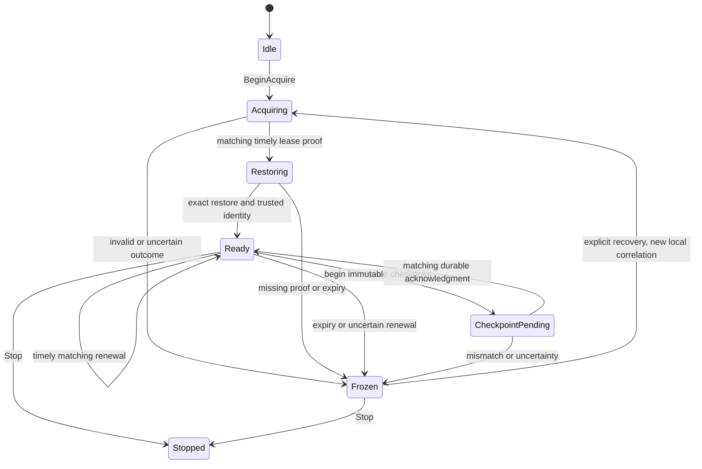

# M15 native hosted authority state foundation

October21,2026 — **Editor/Game/Server builds PASS; native5/5 PASS**.
Trello sfSC5E2o. This is a value-state foundation, **not a deployed hosted feature**.
Actual PFSurvivalGameMode PreLogin and InitNewPlayer retain their unconditional
hosted refusal. PFHostingSubsystem and its SDK lifecycle remain unchanged.

## Code and intended ownership

Hosting/PFHostedAuthorityState.h/.cpp adds a focused game-thread value guard:

- Idle/acquire/restore/ready/pending-checkpoint/frozen/stopped phases.
- Exact lease/epoch binding, monotonically allocated local callback correlations
  (not wire credentials), canonical signed64-bit fence strings and safe head
  generations. A failed/recovered attempt cannot change worlds or forget the
  previously observed fence/durable head floor.
- Conservative request-send-time + requested TTL -1second readiness deadline.
  TTL is integral5–120seconds, matching the draft contract; no reply-time TTL
  extension or local/remote wall-clock subtraction. Invalid/regressing monotonic
  time, expiry and uncertainty freeze. Every readiness query checks expiry without
  requiring a future Tick. A late renewal cannot reopen an already-expired lease.
- Exact restored generation and trusted-server identity prerequisite before value
  readiness. Pending writes keep readiness false and head unchanged; only exact
  current correlation/generation/checksum acknowledgment advances the durable head.
  Uncertain outcomes freeze; late success cannot clear them. Completed/stale
  callbacks cannot change a newer operation, and stopped state is terminal.

The guard performs **no authentication, HTTP, persistence, replication, gameplay
mutation or world deserialization**. Its boolean identity/restore prerequisites
must come only from future trusted validated adapters, never a client RPC/JSON
claim. AcceptLease assumes the caller has already checked authenticated request,
world, server, epoch and response ownership; local callback numbers are not
authorization. The owning subsystem must dispatch to GameThread and use safe weak
lifetime callbacks. There is no automatic timer/network integration here.

All states can be stopped. Frozen recovery still requires a new higher epoch,
non-regressing durable head and fresh exact restoration/identity proof. No state
transition here opens GameMode login or freezes existing gameplay by itself.

## Actual builds and narrow automation

| Target | Toolchain / invocation | Wall seconds | Result |
| --- | --- | --- | --- |
| PrimalFrontierEditor Development Win64 | installed5.8.3, max4actions, no live coding | 34.7547 (UBT34.36) | exit0, no compiler severity |
| PrimalFrontier Development Win64 | installed5.8.3, max4actions | 38.4255 (UBT38.03) | exit0, no compiler severity |
| PrimalFrontierServer Development Win64 | source5.8.3 isolated snapshot, DisableAdaptiveUnity, max4 | 60.5864 (UBT56.67) | exit0, no compiler severity |

Logs C:/UnrealSource/BuildLogs/PrimalFrontier{Editor,Game,Server}_AuthorityState_20261021.log.
Server result receipt uses matching .result.json. Only the three new guard/test
files were copied into the existing isolated worktree; matching SHA checks passed,
no existing differing target was overwritten. Explicit unity sources include the
new files and compiled successfully, rather than relying only on adaptive exclusion.
Engine is actual5.8.3, matching prior source/package verification; no engine
association, Launcher, SDK, project settings or build-version metadata changes.
This Server binary was not restaged, uploaded, allocated or cloud-playtested.

Native selector PF.Hosting.Authority executes five definitions:

1. PF.Hosting.Authority.Durability.
2. PF.Hosting.Authority.ExpiryAndRenewal.
3. PF.Hosting.Authority.Initialization.
4. PF.Hosting.Authority.Recovery.
5. PF.Hosting.Authority.Refusals.

All Success, errors0/warnings0, no missing/unexpected selectors, process exit0.
Run Automation_M15AuthorityFirst_20261020_220950732_bf83124d:47.2seconds,
NullRHI, peak2.983GiB working/2.966GiB private. Raw log independently inspected:
warnings0/errors0/fatal-or-ensure0. No failed build/test in this slice. Values are
for one headless Editor process, not GPU/FPS/stutter or16GiB minimum certification;
build host reports31.93GiB physical RAM. No rendered clients launched.

Report: Saved/AutomationReports/Automation_M15AuthorityFirst_20261020_220950732_bf83124d/index.json
and run-summary.json; HTML export beside them.
Raw log: Saved/Logs/PFAutomation_M15AuthorityFirst_20261020_220950732_bf83124d.log.
Paths use UTC filename October20; user-local test date is October21 Brisbane.

## Reproduce — AI, no playable level needed

Backend-only deterministic value tests; no authored level fixture or personal
world is required. No PIE/net mode or manual device input. The runner opens the
project's Editor automation context without a map override, with NullRHI and
NoSaveConfig; tests create no gameplay world. Close other Unreal processes first.

Start here: PowerShell at C:/UnrealProjects/PrimalFrontier.

1. Build Editor after changes:
   `& 'C:/Program Files/Epic Games/UE_5.8/Engine/Build/BatchFiles/Build.bat' PrimalFrontierEditor Win64 Development '-Project=C:/UnrealProjects/PrimalFrontier/PrimalFrontier.uproject' -WaitMutex -NoHotReloadFromIDE -NoLiveCoding -MaxParallelActions=4`.
2. Run `./Scripts/RunNativeAutomation.ps1 -TestFilter PF.Hosting.Authority -Label M15Authority -TimeoutSeconds 180`.
3. Require exactly five named clean Success records, exit0, no raw log severity,
   and readable HTML/JSON/run-summary in printed unique report path. Stop on any
   failure; preserve log, fix only this guard and replay the failed selector using
   -TestFilter PF.Hosting.Authority.<name> before broader regression.
4. Compile the Game target similarly using PrimalFrontier. Source Server uses the
   existing isolated source-engine snapshot and explicit unity command documented
   in PLAYFAB_SERVER_BUILD_M15.md; copy only reviewed files/hash-verify first.

No player console command or world reset is added. No new asset/fixture, private
save, settings, packaged build, RPC, provider dependency or online permission change.

## Remaining integration gate

Clock-rate/suspend behaviour and the1second reserve require deployment bounds;
monotonic-clock tests do not prove cross-machine lease timing under arbitrary
clock drift. This guard's local callback serial must be mapped to genuine unique
wire request IDs and authenticated proof, not substitute for them. Identity
proof is a caller prerequisite, not implemented PlayFab/EOS verification.
Actual player admission, lease-loss gameplay freeze, transport retries/status
reconciliation, private-world restoration/migrations, stale replica reads and
crash/recycle/reconnect remain unverified.

Current hosted admission **must stay closed** until live runtime role/grants/RLS/
ownership and Worker endpoint/branch binding audit, separately reviewed isolated
migration/legacy write cutover, simultaneous-session contention and authenticated
lease/restore/identity adapters pass. FullM15 is incomplete. The existing49-test
offline SQL/ingress gate remains [separate](CHECKPOINT_INGRESS_PROTOTYPE_M15.md).
