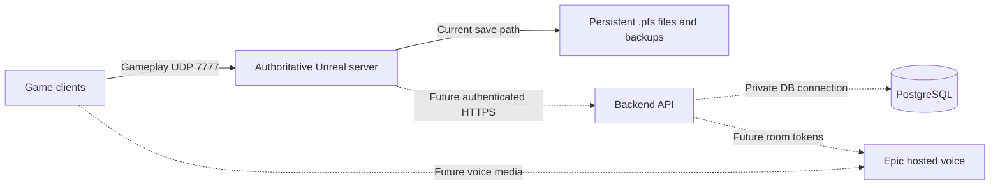

# Server, database and voice setup — current build

**Superseded current setup:** [October15 free/low-cost guide and tested local scripts](MULTIPLAYER_SETUP_2026_10_15.md). Source access has now been independently verified through GitHub API, and the owner account-link step below is complete. Only48.26GiB free remains; build storage is the next prerequisite. Latest user permits very low cost as well as free hosting. This document retains the earlier guide and budget history; its deferred/free-only/source-access-first instructions are historical. No hosted game/SQL/audible voice has been provisioned.

## User budget update: free online hosting only

The user subsequently specified a zero-cost online game host. This supersedes the paid Windows-VM recommendation below; no billable VM, paid database or trial-to-paid upgrade is selected. Official offers checked October15; no account/resource created.

- **Closest ongoing free candidate: Oracle Cloud Always Free A1 (ARM).** Current official allocation is2OCPUs/12GB total (1,500OCPU-hours/9,000GB-hours monthly), not the old4OCPU/24GB figures often repeated in tutorials. Capacity is not guaranteed; home-region provisioning can fail, and idle resources may be reclaimed. Our current Windowsx64 build cannot run on it. First prove a source-built LinuxARM64 dedicated package and all project/plugin/platform dependencies, then measure CPU/memory and durable saves. This is a possible port target, not established compatibility or guaranteed permanent availability. The1GB AMDmicro offer is not a sensible target for our existing roughly1.7–1.8GiB uncooked server process. [Oracle current limits](https://docs.oracle.com/en-us/iaas/Content/FreeTier/freetier_topic-Always_Free_Resources.htm).
- **Free development quota candidate: PlayFab Multiplayer Servers.** Windows/Linux hosting exists, but requires packaged-server GSDK/lifecycle integration and persistent save-storage design; nothing is integrated yet. Quota is limited, not unlimited always-on hosting. Microsoft billing docs state750Dasv4 core-hours/month in EastUS/NorthEurope (e.g.2cores uses2core-hours/hour), whereas the pricing page labels included hours as VM hours. Verify the actual title/plan quota and meter in GameManager before creating resources; don't promise a fullmonth from750headlinehours. Account/payment setup, egress/storage and above-quota charges matter. [Billing](https://learn.microsoft.com/en-us/xbox/playfab/multiplayer/servers/billing-for-thunderhead), [pricing](https://developer.microsoft.com/en-us/games/products/playfab/pricing/), [GSDK requirement](https://learn.microsoft.com/en-us/gaming/playfab/multiplayer/servers/integrating-game-servers-with-gsdk).
- **AWS/Google trial credits:** useful for temporary experiments, not a permanent free Unrealworld; account eligibility, expiration, bandwidth/IP/storage and paid upgrades must be checked. [AWS free-plan FAQ](https://aws.amazon.com/free/free-tier-faqs/), [Google free program](https://docs.cloud.google.com/free/docs/free-cloud-features).
- **Own spare PC:** can be reachable online with appropriate private-network/router setup, but uses your electricity/internet and stops when the machine is off; it is selfhosting, not a free external cloud host. A source-built packaged host is still preferable to distributing an Editor project.

Recommendation for strict ongoing$0cloud goal: assess OracleA1 LinuxARM64 compatibility after source access, without creating billable substitutes. For occasional Windows development sessions evaluate PlayFab's actual free title quota instead. No currently verified, unlimited24/7 free drop-in host exists for this build. Separate EOS-managed voice remains a recommendation and does not provide game simulation hosting. No cloud/database/voice acceptance inferred.

October15,2026. User direction: prepare hosting/persistence infrastructure before implementing audible voice. Guide task https://trello.com/c/27xZNBDw. This is researched setup guidance, not a claim that services were provisioned or the game gained database/voice support. No installation, purchase, firewall/account/engine/project setting, source or asset change was made.

## What exists now

| Part | Current support | Next boundary |
| --- | --- | --- |
| Game server | Actual uncooked UnrealEditor dedicated server +1/2 NullRHI clients passed on the OpenWorld map | Standalone cooked PrimalFrontierServer build is not verified; Launcher distribution previously refused Server targets |
| World persistence | Server-owned versioned/checksummed A/B .pfs snapshots, originals and local reconnect profiles | No PostgreSQL/SQL connector, backend API, online account login or timed autosave |
| Voice | Default-off routing policy and actual authoritative player snapshots tested | No capture/audio relay/provider/device UI or physical listening yet |

Installed Engine/Build/Build.version is5.8.3,CL58210709, under UE_5.8; original requested version5.8.2. Match the actual source-engine baseline deliberately; do not switch engine/upgrade/downgrade in place. Existing Source/PrimalFrontierServer.Target.cs already defines the Server target; don't create another target. Development-only PF commands are absent from Shipping.

## Recommended arrangement



Solid paths exist; dotted paths require implementation/configuration. PostgreSQL does not host Unreal gameplay or audio. Recommended future voice provider: EOS Voice, with Epic operating media servers; keep game simulation under your control. This is a recommendation, not acceptance/provisioning of an online service. No separate self-hosted voice VM is needed for that choice. EOS is advertised free in the [official FAQ](https://onlineservices.epicgames.com/faq); your own game/API/DB/storage still incur their host costs.

## 1. Optional private server with the current installed build

No new engine or database needed for this disposable development test. Close existing Unreal instances and keep one rendered client only. Use a NEW world slot, never a personal save. These commands are documented from the already-tested runner path; this exact manual command was not launched in this guidance task.

PowerShell, on the current development PC:

```powershell
& 'C:\Program Files\Epic Games\UE_5.8\Engine\Binaries\Win64\UnrealEditor.exe' `
  'C:\UnrealProjects\PrimalFrontier\PrimalFrontier.uproject' `
  /Game/PrimalFrontier/Maps/L_PrimalFrontier_OpenWorld `
  -server -game -nullrhi -nosound -log -port=7777 `
  -PFSaveSlot=DevServerM15 -NoLiveCoding
```

1. Wait for `IpNetDriver listening on port 7777`. A startup refusal/error is not success. Current known uncooked engine widget/HLOD/Python startup issues are documented separately; do not dismiss new gameplay/save failures as baseline.
2. Open a SECOND PowerShell for one client:

```powershell
& 'C:\Program Files\Epic Games\UE_5.8\Engine\Binaries\Win64\UnrealEditor.exe' `
  'C:\UnrealProjects\PrimalFrontier\PrimalFrontier.uproject' `
  127.0.0.1:7777 -game -log -windowed -ResX=1280 -ResY=720 `
  -PFIdentityProfile=DevM15A -NoLiveCoding
```

3. Expected: first-person player joins the dedicated OpenWorld server. Another PC uses the SERVER'S reachable LAN/private-network address in place of127.0.0.1 and its own stable profile. That PC needs a compatible project/engine or, after packaging, matching client package. Do not copy/reuse another person's Identity profile. No current main-menu server browser is claimed; launch URL or in-game `open <server-address>:7777` is the diagnostic route.
4. On the SERVER logging console, run `PF.SaveWorld DevServerM15`. Expect `[PrimalAgentTools]` explicit PASS and `[PrimalPersistence] Saved slot=DevServerM15`; Save must not reset the world. A command entered on a remote client's console is refused by design. If the logging console has no command input, do not claim a manual save succeeded: leave the server running and use the existing controlled disconnect-save behavior below or have AI set up a reviewed server-console path.
5. Current ActiveSlot also saves after successful player logout, before that pawn disappears. Disconnect the client normally and confirm the server's Saved log. There is NO timed autosave or guaranteed save on process kill/crash. Confirm a successful write before stopping the server.
6. Files live under `C:\UnrealProjects\PrimalFrontier\Saved\Persistence\DevServerM15.a.pfs`/`.b.pfs` (one or both generations). Never edit them manually. Back up the whole Persistence directory, including Originals, while the server is stopped; keep private identity/capability records protected. Client reconnect profiles are on clients; moving endpoint/profile can affect identity. A/B rotation is not an off-machine backup.
7. Restart with the SAME slot and add `-PFLoadSave` to the server command. Only add it after a confirmed valid save. Expect a successful startup load; missing/corrupt/map-mismatched saves must refuse rather than start fresh. Reconnect using the same client profile AND endpoint; inventory/ownership should restore. The exact domain/IP/port is part of current profile identity, not production accounts.

Keep this on localhost/LAN or an invitation-only private network. Existing GUID capabilities do not certify public-Internet authentication, bans, transport flood protection or secure administration. No public firewall exposure is needed for127.0.0.1. Opening a UDP port alone does not make this a production service.

## 2. Prepare the deployable server build before paying for hosting

Epic's [current dedicated-server guide](https://dev.epicgames.com/documentation/en-us/unreal-engine/setting-up-dedicated-servers-in-unreal-engine) requires a source-built engine. Our installed distribution's Server-target limitation remains; an ordinary Game build succeeding does not remove it.

**First user action:** follow [Epic's GitHub access steps](https://www.unrealengine.com/ue-on-github): link your Epic/GitHub accounts, authorize the link and accept the GitHub organization invitation if access is not already enabled. While signed into GitHub, verify you can open `https://github.com/EpicGames/UnrealEngine`. Reply `SOURCE_ACCESS PASS`, or explain the access error. No source download/payment/password sharing needed for this first step.

Subsequent AI/build work after access is confirmed:

1. Inventory free SSD space/toolchain, verify an appropriate source ref matching the actual5.8.3 baseline. Exact private repo ref is TBD until access is available; do not blindly use latest/main or invent a hotfix tag. Reserve substantial extra space (planning allowance400–500GB; measure before download), and keep this engine OUTSIDE the game repo/Launcher installation.32GB host still needs constrained parallel builds; don't run the Editor during a full engine build.
2. Fetch the reviewed source ref into a separate engine folder, run Setup.bat and GenerateProjectFiles.bat, then build Development Editor Win64. Review licensing/account prompts personally. AI can handle normal build work; no current project conversion is performed by this guide.
3. Use a protected project checkout/copy for source-engine compatibility; build PrimalFrontierEditor, PrimalFrontierServer and the matching game client. Resolve only actual compile/platform/plugin failures. Launcher-precompiled plugins may need source-compatible builds or an explicit replacement decision. No Server success is assumed.
4. Cook/stage/package the Server map `/Game/PrimalFrontier/Maps/L_PrimalFrontier_OpenWorld`, referenced catalogs and approved runtime content; package matching clients. Verify editor-only tooling exclusions and necessary Development-only console availability. Do not blindly ship all staged Fab assets or include engine source/private project files in deployments.
5. Run the packaged server and client locally, then on the target OS: join, gather/craft/build/storage, save, stop, restart/load, reconnect and second-client authority. Keep reports/logs/backups. Local compile or uncooked metadata tests do not certify cooked deployment.

This source access/packaging gate is why buying a generic "Unreal game server" subscription today is premature.

## 3. Host the game server

Initial deployment recommendation is Windows x64 to match the tested platform. A Linux server is a later build/cook/platform gate, not interchangeable with a Windows .exe. Choose a host that permits YOUR executable, UDP traffic, persistent SSD, restricted administration and backups.

Planning estimate for a few invited testers:4fast vCPUs,16GB RAM, persistent SSD sized after staging (100–200GB starting allowance), no GPU; choose a region near players, e.g. Sydney for Australian testing. These are conservative starting estimates, NOT measured player-capacity/minimum-spec or a provider price quote. Current small NullRHI diagnostics used around1.7–1.8GiB/server, not a long-lived busy world. Source compilation needs much more storage than running a packaged server. Don't rent a GPU/managed database or long contract before the package gate.

Once package passes:

1. Create a host account/VM you control; record region, OS, CPU/RAM/storage and billing limit. User makes account/payment/terms decisions. AI can prepare deployment/configuration once the host is chosen.
2. Upload the complete staged Server package and required prerequisites, not just Server.exe or the whole repository. Use a dedicated nonadministrator runtime account and writable persistent save directory; inspect actual logged Saved path in the staged layout rather than assuming the editor path.
3. Restrict management access to your admin IP/private network. Allow gameplay UDP7777 only for invited test addresses/private network initially. No public PostgreSQL5432 or unrestricted RDP3389. Add only ports actually used by a selected backend/provider; don't open arbitrary Steam/query/voice ports preemptively.
4. Start one world process per save slot/data directory and port. Use the approved map and new `-PFSaveSlot=...`; restart existing worlds with `-PFLoadSave`. The exact packaged launch executable/relative path depends on staging and must be verified, not invented here.
5. Add process supervision/restart policy and off-host backups AFTER graceful save/shutdown/restart behavior is implemented/verified; no automatic kill/restart during writes. Watch RAM/CPU/tick time/disk/growth. Test restore into an isolated instance before relying on backups.

Current content/save caps and developmental identity remain; extra VM RAM does not make the32identity save bound unlimited. Production permissions/accounts, safe admin endpoints, periodic server saves and orderly shutdown are AI implementation tasks, not solved by renting the machine.

## 4. Prepare PostgreSQL, then integrate it through a server backend

You CAN host a private world now without SQL. PostgreSQL preparation is useful for future accounts/world metadata/shared services, but installing it alone will not move a single current .pfs save into a database. The game presently has no DB connection-string setting to fill in.

For the first development database, either install supported stable PostgreSQL on the future backend host or use a managed PostgreSQL instance with private networking. Co-location is economical for small development, but must be sized separately from the game process. Do not add it to the already busy gaming PC just to claim hosting is complete. See the [official Windows installer page](https://www.postgresql.org/download/windows/) or your chosen host's supported stable package; avoid beta versions.

Same-host development setup:

1. Install PostgreSQL on the backend/DB host; keep administrator password in your password manager. Use SQL Shell (psql) as the local postgres administrator for the following initial setup.
2. Create a dedicated DEVELOPMENT application role/database (not a superuser), and set the password interactively:

```sql
CREATE ROLE pf_app LOGIN NOSUPERUSER NOCREATEDB NOCREATEROLE NOREPLICATION;
\password pf_app
CREATE DATABASE primalfrontier_dev OWNER pf_app;
REVOKE CONNECT ON DATABASE primalfrontier_dev FROM PUBLIC;
GRANT CONNECT ON DATABASE primalfrontier_dev TO pf_app;
```

`\password` is a psql command, not SQL for pgAdmin's query editor. Enter a unique generated password at its prompts; do not paste passwords into a shared guide, shell argument, chat, Trello or Git. Run once on a fresh instance; existing names mean inspect the existing DB/role instead of dropping/replacing it. The role owns this dev DB; production needs separate migration owner/runtime least-privilege roles once schema is designed.

3. For a co-located API/DB, bind PostgreSQL to localhost and permit only intended loopback application connections with SCRAM password auth in pg_hba.conf. Retain needed administrator rules. If API and DB are on different hosts, use private networking, narrowly scoped application source addresses and verified TLS; don't just set listen_addresses='*' or trust allclients. Follow [PostgreSQL connection/authentication docs](https://www.postgresql.org/docs/current/auth-pg-hba-conf.html).
4. In psql, test a separate connection as pf_app to127.0.0.1:5432/primalfrontier_dev and run `SELECT current_database(), current_user;`. Expected primalfrontier_dev/pf_app. This proves only DB connectivity, not game integration.
5. Add automated protected DB backups and test restore into a different database. PostgreSQL [pg_dump guidance](https://www.postgresql.org/docs/current/backup-dump.html) covers logical backups; include secure role/restore planning. VM snapshots alone are not a tested DB restore.
6. AI then implements an authenticated HTTPS backend and versioned schema/migrations. Only trusted server/backend code holds DB credentials; clients request authorized operations, never receive a database password. Use async/coalesced checkpoint work, not SQL per actor per tick. Validate ownership, versions, transaction/idempotency and failure/retry behavior before migration. Existing .pfs files remain authoritative until an explicit data migration/rollback/restart test passes; no dual-authority shortcut or guessed world tables.

The hosted voice provider doesn't need recordings in this database. Do not store audio or private voice tokens in ordinary world saves/logs/reports.

## 5. Managed voice hosting recommendation: Epic Online Services

EOS hosts voice media; your own trusted backend manages room access/tokens. It does not host Primal Frontier's Unreal world simulation or replace PostgreSQL. The [official EOS voice guide](https://dev.epicgames.com/documentation/en-us/unreal-engine/voice-chat-with-epic-online-services) describes product configuration and trusted-server integration.

After server packaging/host direction is settled:

1. User signs into the Epic Developer Portal and creates/selects the Primal Frontier product and DEVELOPMENT sandbox/deployment. Record that it exists, not secret values in chat. Accept service agreements yourself; no product/account created by this guide. If the portal layout differs, follow its current product setup workflow rather than an invented UI path.
2. Configure appropriate client policies and trusted-server voice/token permissions. Keep privileged token-minting credentials in server-side secure configuration only; scoped client configuration and privileged admin credentials are not interchangeable.
3. AI enables the reviewed engine VoiceChat/EOSVoiceChat dependencies and implements validated player identity mapping, trusted room tokens and their expiry/refresh, room join/leave, explicit opt-in/PTT, volume/mute/block/device UI and dedicated-server behavior. This is not yet present in the current build. No lobby autojoin should bypass consent.
4. Enforce proximity against authoritative positions and real authenticated origin/room membership. Installed EOSVoiceChat Set3DPosition is unimplemented here; a single room plus client-side volume is not an authoritative distance/privacy boundary. Reuse the verified policy, but separately prove actual media admission/routing. No production claim until that design passes.
5. Run one then two low-memory network clients, then an actual TWO-device/person listening test for opt-in, PTT, near/far, mute/block, reconnect and disable. Capture readable evidence without recording private speech. Exact playable UI controls/fixture remain TBD until implemented; don't try a microphone test now.

## Do first / checkpoints

**Do first only:** verify Epic Unreal source repository access and report `SOURCE_ACCESS PASS`. If already linked, simply verify access. Do not rent a server, install a DB, download a different engine or buy voice hosting yet. This is an account-access check, not a gameplay test; it needs the account owner.

Then: reviewed source-engine/package gate → private hosted game server with current .pfs backups → private DB+API scaffold/integration → chosen managed voice integration → physical listening acceptance. Database/voice account preparation can be planned in parallel, but no paid provisioning is necessary to unblock source access.

Evidence for current foundation: PROXIMITY_VOICE_AUTHORITY_M15.md and prior persisted one/two-client restart reports in SERVER_SETUP_FEEDBACK_M11.md/PERSISTENCE_M8.md. This task only read source/docs and refreshed official references; no build/launch/service test was run and no prior test has been relabeled as cloud, PostgreSQL or audio acceptance.
